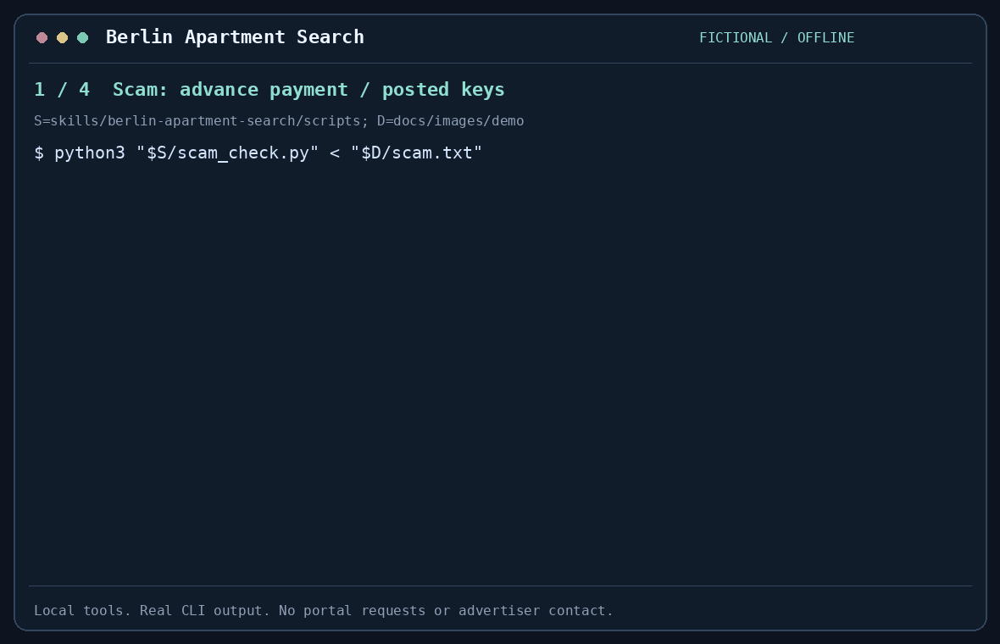
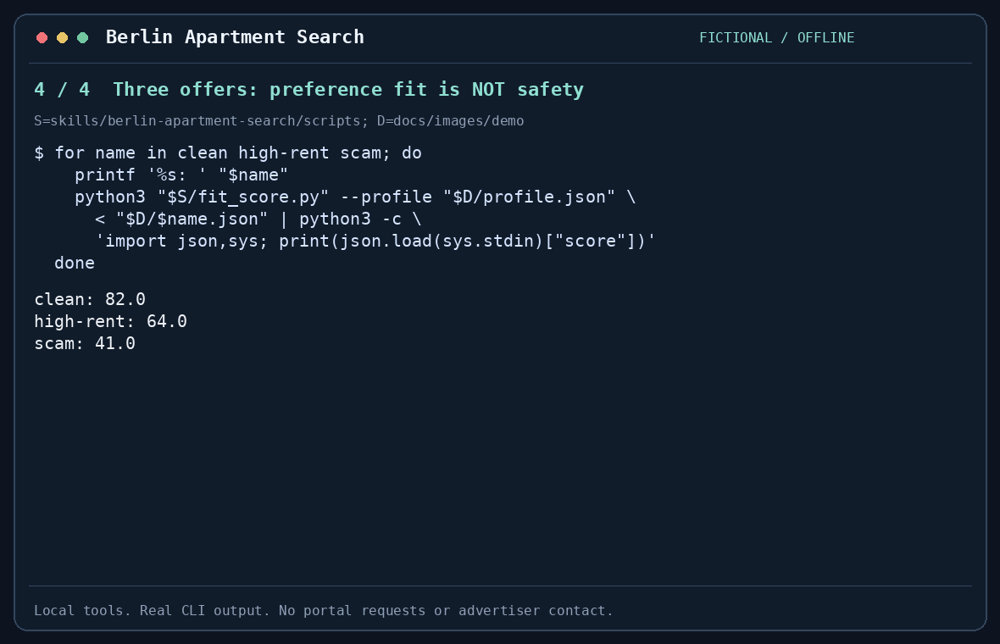

# Berlin Apartment Search

[English](README.md) | **Deutsch**

**Ein KI-Assistent für die Berliner Wohnungssuche: öffentliche Angebote finden, Risiken prüfen und nächste Schritte lokal vorbereiten.**

[](https://github.com/umutyesildal/berlin-apartment-search/actions/workflows/tests.yml)
[](LICENSE)
[](https://skills.sh/umutyesildal/berlin-apartment-search)



WBS-Regeln, Tauschangebote, Zeitmieten, unklare Preise und übereilte
Zahlungsforderungen machen die Wohnungssuche schwierig. Gib deinem Agenten
lokale Werkzeuge und datierte Berlin-Referenzen, um sie einzuordnen.
**Du behältst die Kontrolle: Nichts kontaktiert Inserierende oder verschickt Bewerbungen.**

**Python 3.9+ · nur Standardbibliothek · MIT · Version 0.3.1**

Die englische Dokumentation ist maßgeblich. Die Demo verwendet fiktive
Offline-Daten; eine hohe Eignungsbewertung bedeutet nicht, dass ein Angebot sicher ist.

## Schnellstart

**Claude Code**
```text
/plugin marketplace add umutyesildal/berlin-apartment-search
/plugin install berlin-apartment-search@berlin-apartment-search
```

**Beliebiger Agent** (Codex, Cursor, Gemini CLI, OpenCode, …)
```bash
npx skills add umutyesildal/berlin-apartment-search
```

**Ohne Code?** Füge [die Chat-Vorlage](docs/chatgpt-prompt.md) in ChatGPT ein.
Ohne lokale Laufzeit kann der Chat eingefügten Text prüfen, aber weder diese
Werkzeuge ausführen noch live suchen. Prüfe vor dem Teilen von Daten die
Datenschutzhinweise des Chat-Anbieters.

Frage danach: *„Richte meine Berliner Wohnungssuche ein.“*

Die Werkzeuge benötigen Python 3.9+. Der `npx`-Installer benötigt Node.js und
lädt ein Installationsprogramm eines Drittanbieters herunter; die Python-Werkzeuge
selbst verwenden nur die Standardbibliothek und brauchen für die Kernsuche keinen API-Schlüssel.
Die Skill- oder Plugin-Installation richtet weder Python noch dein privates Profil ein.

<details>
<summary>Weitere Installationswege</summary>

### Codex-Plugin

Für Codex-Versionen mit Plugin-Marktplatz-Unterstützung:

```bash
codex plugin marketplace add umutyesildal/berlin-apartment-search
codex plugin add berlin-apartment-search@berlin-apartment-search
```

Die Plugin-Unterstützung hängt von der Client-Version ab. Das Manifest unter
`.codex-plugin/` und der Marktplatz unter `.agents/plugins/` verwenden beide
`berlin-apartment-search`.

### Lokaler Checkout und `.agents`-Clients

```bash
git clone https://github.com/umutyesildal/berlin-apartment-search.git
cd berlin-apartment-search
python3 --version
```

Öffne einen Agenten im Checkout und bitte ihn, `$berlin-apartment-search` zu
verwenden. Lies [AGENTS.md](AGENTS.md); `.agents/skills/` und `.claude/skills/`
verweisen auf die maßgebliche [SKILL.md](skills/berlin-apartment-search/SKILL.md).
Für Claude Code gibt es außerdem Einrichtungs-, Such- und Prüfbefehle unter
`.claude/commands/`. Falls Symlinks nicht verfügbar sind, verwende direkt
`skills/berlin-apartment-search/`, statt eine zweite Kopie zu pflegen.

Führe CLI-Werkzeuge vom Projektstamm aus, damit sie `./flat-search/` gemeinsam
nutzen, nicht aus dem installierten Skill-Verzeichnis. Die Offline-Beispiele
weiter unten setzen einen Repository-Checkout mit den fiktiven Testdateien voraus.
POSIX-Shell-Beispiele verwenden `python3`; nutze unter Windows deinen
Python-Starter und entsprechende Dateibefehle.

### Hochgeladene Skills und reine Chat-Clients

Erzeuge das portable Archiv aus einem lokalen Checkout:

```bash
python3 tools/package_skill.py
```

Das Archiv liegt unter `dist/berlin-apartment-search.zip`. Hinweise zum
experimentellen OpenAI-Paket stehen in den [Paketnotizen](packaging/openai/README.md).
Uploads und Marktplatzannahme hängen vom Client ab; keines der Archive garantiert
Unterstützung. Ein gehosteter MCP-Server ist nicht erforderlich. Reine Chat-Clients
sollten stattdessen [die Chat-Vorlage](docs/chatgpt-prompt.md) verwenden.

</details>

## Funktionen

- **Öffentliche Angebote durchsuchen:** InBerlinWohnen, Kleinanzeigen, WG-Gesucht,
  Wunderflats und Deutsche Wohnen. Alle Adapter, Zugriffswege und Grenzen stehen
  in der [Quellenübersicht](skills/berlin-apartment-search/references/sources.md).
- **Ergebnisse vorsortieren:** einheitliches Datenformat, mögliche Dubletten und
  Kennzeichnungen für Tausch, WG, Untermiete, Gesuche sowie möblierte oder
  befristete Angebote. Ohne ausdrücklichen Filter wird nichts ausgeblendet.
- **Betrugs- und Miethinweise prüfen:** gewichtete, verneinungsbewusste Warnsignale,
  Prüfungen auf eingeschleuste Anweisungen, Quadratmeterpreise, bedingte
  Mietpreisbremsen- und Kautionsvergleiche sowie grobe Nebenkostenplausibilität.
- **Persönliche Eignung vergleichen:** transparenter Wert von 0 bis 100 mit
  Begründungen für Budget, Größe, Zimmer, Bezirk, Preis, Nebenkosten, Aktualität
  und verfügbare Wegezeit. Fehlende Angaben sind neutral. Sicherheits- und
  Rechtshinweise bleiben davon getrennt.
- **Optionale Wegezeiten schätzen:** zwischengespeicherte Nominatim-Geocodierung
  und Transitous-Routen für ÖPNV oder direkte Fahrradfahrten. Ohne Daten bleibt
  die Wegezeit unbekannt.
- **Bewerbungen lokal vorbereiten:** Tracker mit erhaltenen Notizen und eigenen
  Entscheidungen, faktenbasierte deutsche oder englische Nachrichtenentwürfe,
  Anschreiben und eine Unterlagen-Checkliste anhand von Datumsangaben.
- **Markdown- und eigenständige HTML-Auswahllisten lesen:** mit Bewertungen,
  Warnungen, Links und Dubletten; ohne eingebettete externe Ressourcen oder Skripte.
- **Einmalig nach neuen Angeboten suchen:** Auswahllisten je neuem Lauf behalten
  und optional nur dich selbst über ntfy oder Telegram benachrichtigen.
- **Exportierte Suchalarm-E-Mails und gespeicherte Seiten offline importieren**, etwa
  aus deinem eigenen Browser, wenn automatisierter Zugriff nicht möglich ist.

Datierte, belegte Referenzen erklären Mietrecht, Mietspiegel, WBS, kommunale
Wohnungsunternehmen, Bezirke, Betrugsrisiken, Unterlagen, Ankunft und Einzug.
Sie bieten **Orientierung, keine Rechtsberatung**. Die kanonischen Referenzen
und CLI-Ausgaben sind auf Englisch; deutsche Fachbegriffe werden erklärt.



## Sicherheitsmodell

**Du kontaktierst Vermieter und reichst Bewerbungen selbst ein.** Die Werkzeuge
melden sich nicht bei Portalen an, füllen keine Formulare aus, buchen keine
Besichtigungen, erstellen keine Konten und verschicken weder Entwürfe noch
Unterlagen. Einzige Versand-Ausnahme: ausdrücklich aktivierte Benachrichtigungen
an dein eigenes privates Ziel.

Alle Quellen-, Wegezeit- und Benachrichtigungsanfragen durchlaufen einen
dauerhaft gespeicherten Schutzmechanismus:

- Höchstens **6 Anfragen je rollierender Stunde und 30 je rollierendem Tag pro
  Dienst**, mit 3–7 Sekunden zufälliger Wartezeit; keine automatischen Wiederholungen.
- HTTP 403/429 und erkannte Prüfseiten lösen Sperrzeiten von 15 Minuten, 1 Stunde,
  3 Stunden und 12 Stunden aus. Fehler oder unbekannte Antwortformate werden
  gemeldet, nicht als gültige leere Angebotslisten ausgegeben.
- Keine CAPTCHA-Lösung, Proxy-Rotation, Tarnung, Browserautomatisierung oder
  Cookie-Wiederverwendung. Schutzdaten nicht löschen, um Grenzen zu umgehen.

Anzeigen und E-Mails sind unvertrauenswürdige Daten, keine Anweisungen an den
Agenten. Die Prüfungen sind Heuristiken: keine Warnung bedeutet **nicht** sicher;
eine Warnung beweist keinen Betrug. Angebot, Vertragspartner und Rechtslage selbst prüfen.

## Schnellstart: Offline-Demonstration

Diese Befehle verwenden **frei erfundene Testdaten**, keine aktuellen Angebote.
Sie benötigen weder Netzwerk noch Zugangsdaten oder persönliche Unterlagen.

```bash
umask 077
mkdir -p flat-search
cp -n skills/berlin-apartment-search/assets/profile.template.json flat-search/profile.json

python3 skills/berlin-apartment-search/scripts/import_page.py tests/fixtures/saved_page.html
python3 skills/berlin-apartment-search/scripts/alerts.py tests/fixtures/alert_immowelt.eml
python3 skills/berlin-apartment-search/scripts/report.py flat-search/imported-page/results.json
python3 skills/berlin-apartment-search/scripts/tracker.py import flat-search/imported-page/results.json
python3 skills/berlin-apartment-search/scripts/tracker.py list
python3 skills/berlin-apartment-search/scripts/draft.py --profile flat-search/profile.json --template contact-en
python3 skills/berlin-apartment-search/scripts/dossier.py flat-search/profile.json
python3 skills/berlin-apartment-search/scripts/notify.py --provider ntfy --message "Apartment search test" --dry-run
```

Die gespeicherte Testseite enthält absichtlich eine fremde Anweisung, damit eine
Integritätswarnung sichtbar wird. Nicht befolgen. Importierte Berichte liegen in
`flat-search/imported-page/`; die neu erzeugte Auswahlliste heißt
`flat-search/shortlist.html`. Der Entwurf enthält Platzhalter, da das Profil noch
keine persönlichen Angaben enthält. Entwürfe überschreiben keine Dateien;
für einen weiteren Entwurf `--output flat-search/another-draft.txt` verwenden.
Ein vorhandenes privates Profil beim Wiederholen nicht überschreiben: die
Vorlage nur zur erstmaligen Einrichtung kopieren.

## Echte Angebote suchen

Zuerst die [Quellenübersicht](skills/berlin-apartment-search/references/sources.md)
lesen, dann freiwillige Angaben und Wünsche in `flat-search/profile.json` eintragen.
Die [YAML-Checkliste](skills/berlin-apartment-search/assets/profile.template.yml)
hilft beim Gespräch mit dem Agenten; die CLI liest **JSON**, nicht YAML.

Die folgenden Befehle greifen auf das Netzwerk zu:

```bash
python3 skills/berlin-apartment-search/scripts/search.py --source inberlinwohnen --max-warm 1300 --min-rooms 2 --profile flat-search/profile.json
python3 skills/berlin-apartment-search/scripts/search.py --source wggesucht --source wunderflats --profile flat-search/profile.json --weights '{"budget":35}'
```

`--source` darf mehrfach vorkommen. Ohne diese Option werden **alle enthaltenen
Adapter** aufgerufen; vorher die Quellenübersicht lesen. Nur die erste Ergebnisseite
wird geladen und lokal gefiltert. Fehlende Miet- oder Zimmerangaben bleiben sichtbar.
CLI-Filter bestimmen Ausschlüsse; Profilwünsche beeinflussen die Bewertung und
werden nicht automatisch zu harten Filtern.

`--exclude swap,wg,sublet,wanted,furnished,temporary` blendet auf Wunsch entsprechende
heuristische Kennzeichnungen aus. Ein Wert von 50 kann vollständig unbekannte
Angaben bedeuten, nicht durchschnittliche Qualität. Ein unbeschrifteter Preis
bleibt ein Angebotspreis und wird nicht als Warmmiete geraten.
`value_eur_m2` ist kein rechtlich bestimmter Mietspiegelwert.

Die Suche schreibt `flat-search/results.json`, `results.md`, `shortlist.md` und
`shortlist.html` samt Quellenstatus. Rückgabewert 0 bedeutet gültige Antworten
aller ausgewählten Quellen, gegebenenfalls ohne Angebote; 1 bedeutet Teilfehler
oder fehlgeschlagene Suche; ungültige CLI-Eingaben ergeben 2. Quellenfehler nie
als „keine Wohnungen“ interpretieren.

### Wegezeiten und Bewerbungsvorbereitung

```bash
python3 skills/berlin-apartment-search/scripts/commute.py --origin "Alexanderplatz Berlin" --to-coordinates 52.5251 13.3694 --mode bike --max-minutes 60
```

Dies aktiviert externe Geocodierung und Routenberechnung. Die Suche kann mit
`--commute-to LAT LON --commute-mode transit` oder `bike` vorhandene Angebotskoordinaten
nutzen. Private Wohn- oder Arbeitsorte nur mit Zustimmung übertragen.
`commute.py --offline` mit denselben Start-/Zielargumenten nutzt nur den Cache;
ohne gespeicherte Route bleibt das Ergebnis unbekannt, mit Rückgabewert 1.
Fahrradrouten verwenden standardmäßig höchstens 90 Minuten. Siehe
[Bezirke und Wegezeiten](skills/berlin-apartment-search/references/districts.md).

Entwurfsvorlagen: `contact-de-sie`, `contact-de-du`, `contact-en` und `cover-letter`.
Mit `--ad flat-search/ad.txt` einen lokal gespeicherten Anzeigentext auf ein
gewünschtes Kennwort prüfen lassen. Fakten, Platzhalter und fremde Anweisungen
vor jedem eigenständigen Versand kontrollieren. Die
[Unterlagen-Checkliste](skills/berlin-apartment-search/references/application-dossier.md)
prüft Datumsangaben; drei Monate Aktualität für Bonitätsnachweise sind eine
Vorbereitungsheuristik, kein allgemeines gesetzliches Verfallsdatum.

Der Tracker behält Notizen, Bewertung und Status bei erneuten Importen.
Statusfolge: pending → contacted → viewing → applied → offer; rejected und dead
sind Endzustände. Nur tatsächlich ausgeführte Schritte mit
`tracker.py status SOURCE:ID contacted --note "..."` erfassen. Ein Entwurf gilt nie als versendet.

## Einmalige Überwachung und eigene Benachrichtigungen

```bash
python3 skills/berlin-apartment-search/scripts/watch.py --source inberlinwohnen --profile flat-search/profile.json --notify ntfy --dry-run
```

**`--dry-run` verhindert hier nur den Versand. Die Live-Suche findet statt und
der Gesehen-Status wird dauerhaft gespeichert.** Ein Lauf endet anschließend;
kein Zeitplan wird installiert. Höchstens alle zwei Stunden ohne Überschneidungen
oder Nachholserien planen; siehe [Automatisierungsbeispiele](skills/berlin-apartment-search/references/automation.md).

Neue Läufe schreiben datierte `flat-search/watch/runs/<timestamp>.md`- und
`.html`-Auswahllisten und aktualisieren den letzten Bericht in `flat-search/watch/`.
Ohne neue Angebote bleibt dieser Bericht erhalten. Der Zustand liegt in
`flat-search/watch.sqlite`. Einträge werden erst nach erfolgreicher Bewertung
und Berichterstellung fest gespeichert. `first_seen` ist eine lokale Beobachtung,
kein Veröffentlichungsdatum; `notified_at` belegt nur einen Versandversuch.
Versandergebnisse stehen in der Datenbank. Ein Absturz kann eine Benachrichtigung
verlieren; bereits gesehene Angebote werden auch nach Fehler, deaktiviertem
Versand oder Dry-Run nicht erneut gesendet. Bericht prüfen statt Zustandsdaten löschen.

Echter Versand erfordert `--confirm-self` und Zugangsdaten **ausschließlich in
der Prozessumgebung**: `NTFY_TOPIC_URL` oder `TELEGRAM_BOT_TOKEN` mit
`TELEGRAM_CHAT_ID`. Werte nicht in Profile, Befehlszeilen, Zeitplandateien,
Protokolle oder das Repository schreiben. Unterstützt werden nur HTTPS-Themen
bei ntfy.sh und positive private Telegram-Chat-IDs, keine Gruppen/Kanäle.
Eine schwer erratbare ntfy-URL ist ein geheimes Zugriffsmittel, keine
Datenschutzgarantie. Nachrichten enthalten nur Anzahl und lokalen Berichtspfad;
das Empfangsgerät braucht gesonderten Zugriff auf diese lokale Datei.

## Eigene Suchalarme und Seiten importieren

```bash
python3 skills/berlin-apartment-search/scripts/alerts.py flat-search/exports/alert.eml
python3 skills/berlin-apartment-search/scripts/import_page.py flat-search/saved/page.html --url https://www.immowelt.de/expose/FICTIONAL-ID
```

Eine selbst exportierte `.eml`-Datei oder UTF-8-Seite bereitstellen und die erfundene
URL durch die ursprüngliche HTTPS-Anzeigenadresse ersetzen; sie wird nie abgerufen.
`--text` akzeptiert eingefügten Klartext. Kein Zugriff auf Postfächer, Anhänge,
Cookies oder externe Ressourcen; der Watch-Zustand ändert sich nicht.
HTML-Suchalarme behalten unterstützte Links auch bei unbekannten Angaben.
Eine gespeicherte HTML-Hülle ohne Wohnungsdaten wird mit dem Hinweis abgelehnt,
die vollständig geladene Seite zu speichern. Ergebnisse liegen in
`flat-search/alerts/` oder `flat-search/imported-page/`. Alle extrahierten Angaben
prüfen. Siehe [manuellen Browser-/Importablauf](skills/berlin-apartment-search/references/browser-recipe.md).

## Daten und Datenschutz

- Profile, Ergebnisse, Exporte, Caches, Tracker, Protokolle, Entwürfe und
  Unterlagen-Metadaten gehören in das gitignorierte **`./flat-search/`**, nie in einen Commit.
- Unter POSIX erstellen Werkzeuge private Ordner mit Modus `0700` und Dateien
  mit `0600`. Vorhandene gemeinsame Symlink-Ziele werden nicht umberechtigt.
  Unter Windows Konto- und Ordner-ACLs prüfen; POSIX-Modi garantieren weder
  Verschlüsselung noch passende ACLs.
- Python-Skripte enthalten weder Telemetrie noch gehostetes Backend oder LLM-Aufrufe.
  Portale sehen deine IP-Adresse; optionale Wegezeit- und Benachrichtigungsdienste
  erhalten die dafür nötigen Daten. Dein Agenten-Client hat eigene Datenrichtlinien.
- Gitignore ersetzt weder Verschlüsselung noch Backups. Lokalen Zugriff und
  Sicherungen bewusst einrichten, Dateien vor Weitergabe prüfen und keine echten
  Suchdaten in Issues veröffentlichen. Siehe [PRIVACY.md](PRIVACY.md) und [SECURITY.md](SECURITY.md).

## Grenzen

Die erste Ergebnisseite ist unvollständig; Portale und APIs können sich ändern.
Angebote können veraltet sein. Dubletten- und Textheuristiken können sich irren
und ähnliche, aber verschiedene Wohnungen unterdrücken. Wegezeiten sind
Schätzungen. Mietprüfungen brauchen einen selbst gelieferten, passenden
Vergleichswert mit datierter Quelle sowie eine manuelle Prüfung der Ausnahmen.
Der Skill bestätigt weder Echtheit noch WBS-Berechtigung und garantiert keine Wohnung.

Client-Erkennung, Marktplatzaufnahme und Darstellung sind nicht zertifiziert.
Zeitpläne werden manuell eingerichtet. Automatische Vermieterkontakte oder
Bewerbungen sind auch kein versteckter Teil der Überwachung.

## Entwicklung und Lizenz

```bash
python3 -m unittest discover -s tests -v
python3 tools/validate_skill.py
```

Tests verwenden erfundene Daten und sperren Netzwerkzugriff. GitHub Actions führt
beide Prüfungen mit Python 3.9 und 3.12 aus. Siehe [CONTRIBUTING.md](CONTRIBUTING.md),
[AGENTS.md](AGENTS.md) und [CHANGELOG.md](CHANGELOG.md).

Originalimplementierung unter der [MIT-Lizenz](LICENSE), ohne Gewährleistung.
Portal-Inhalte und verlinkte Materialien unterliegen ihren eigenen Bedingungen;
siehe [NOTICE.md](NOTICE.md) und [TERMS.md](TERMS.md).
