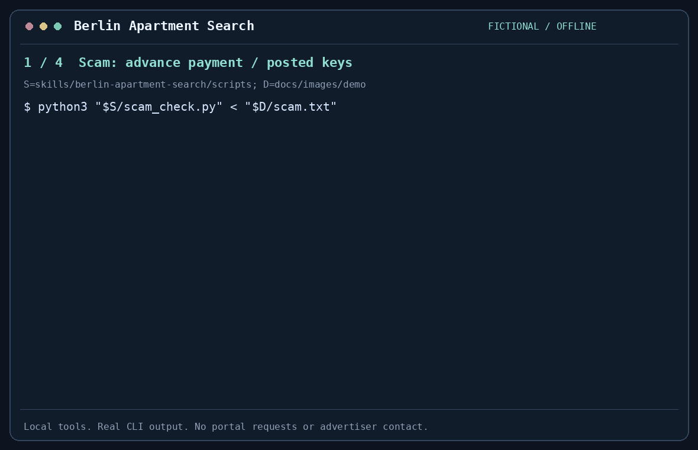
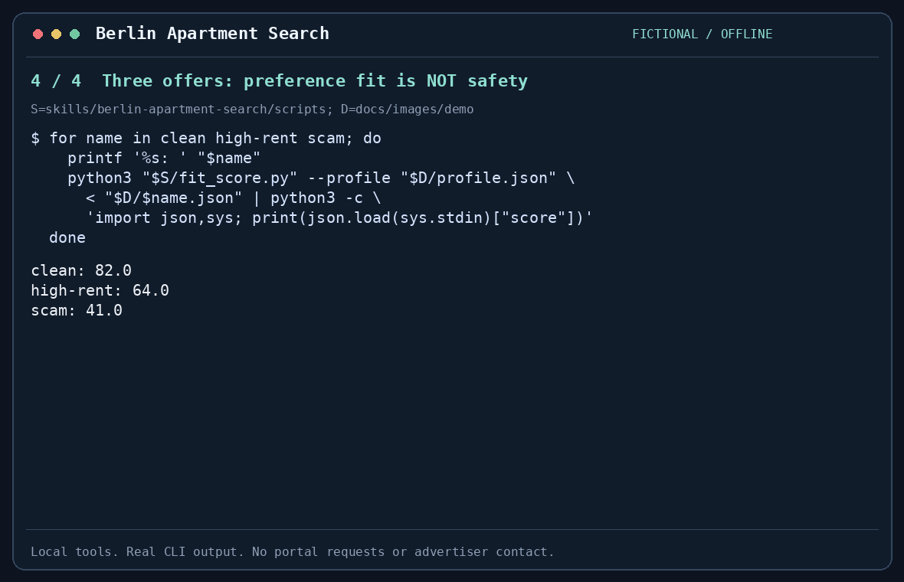

# Berlin Apartment Search

**English** | [Deutsch](README.de.md)

**An AI apartment-search copilot for Berlin: find public offers, check the risks, and prepare your next steps locally.**

[](https://github.com/umutyesildal/berlin-apartment-search/actions/workflows/tests.yml)
[](LICENSE)
[](https://skills.sh/umutyesildal/berlin-apartment-search)



Berlin apartment hunting means navigating WBS rules, swaps, temporary rentals,
unclear prices and rushed payment requests. Give your agent local tools and
dated Berlin references to work through them. **You stay in control: nothing
contacts advertisers or submits applications.**

**Python 3.9+ · standard library only · MIT · version 0.3.1**

English is the canonical documentation. The demo uses fictional offline data;
a high fit score does not mean an offer is safe.

## Quick start

**Claude Code**
```text
/plugin marketplace add umutyesildal/berlin-apartment-search
/plugin install berlin-apartment-search@berlin-apartment-search
```

**Any agent** (Codex, Cursor, Gemini CLI, OpenCode, …)
```bash
npx skills add umutyesildal/berlin-apartment-search
```

**No code?** Paste [the chat prompt](docs/chatgpt-prompt.md) into ChatGPT.
Without a local runtime, chat can review pasted text but cannot run these tools
or search live. Check your chat provider's privacy policy before sharing data.

Then ask: *“Set up my Berlin apartment search.”*

Python 3.9+ is needed to run the tools. The `npx` installer needs Node.js and
downloads a third-party installer; the Python tools themselves use only the
standard library and need no API key for core search.
Installing a skill or plugin does not install Python or create your private profile.

<details>
<summary>More ways to install</summary>

### Codex plugin

For Codex versions with plugin marketplace support:

```bash
codex plugin marketplace add umutyesildal/berlin-apartment-search
codex plugin add berlin-apartment-search@berlin-apartment-search
```

Plugin support depends on the client version. The `.codex-plugin/` manifest and
`.agents/plugins/` marketplace both use `berlin-apartment-search`.

### Local checkout and `.agents` clients

```bash
git clone https://github.com/umutyesildal/berlin-apartment-search.git
cd berlin-apartment-search
python3 --version
```

Open an agent in the checkout and ask it to use `$berlin-apartment-search`.
Read [AGENTS.md](AGENTS.md); `.agents/skills/` and `.claude/skills/` link to the
canonical [SKILL.md](skills/berlin-apartment-search/SKILL.md).
Claude Code also has setup, search and review commands in `.claude/commands/`.
If symlinks are unavailable, point your client to the canonical
`skills/berlin-apartment-search/` directory instead of maintaining another copy.

Run CLI tools from your project root so they share `./flat-search/` state,
not from inside the installed skill directory. The offline examples below use
a repository checkout, which includes the fictional test fixtures. POSIX-shell
examples use `python3`; on Windows, use your launcher and equivalent file commands.

### Uploaded skills and chat-only clients

From a local checkout, build the portable archive:

```bash
python3 tools/package_skill.py
```

The archive is written to `dist/berlin-apartment-search.zip`. For an experimental
OpenAI-style bundle, see [packaging notes](packaging/openai/README.md).
Uploads and marketplace acceptance depend on the client; neither archive
guarantees support. No hosted MCP server is required. Chat-only clients should
use [the chat prompt](docs/chatgpt-prompt.md) instead.

</details>

## What you can do

- **Search public listings** from InBerlinWohnen, Kleinanzeigen, WG-Gesucht,
  Wunderflats and Deutsche Wohnen. See the [full source reference](skills/berlin-apartment-search/references/sources.md)
  for all adapters, access methods and limits.
- **Triage results** with one normalized listing format, possible-duplicate
  groups, and tags for swaps, shared rooms, sublets, wanted ads and furnished or
  temporary rentals. Nothing is excluded unless you ask.
- **Review scam and rent signals:** weighted, negation-aware warnings;
  prompt-injection checks; rent per square metre; conditional rent-cap and
  deposit checks; and broad ancillary-cost plausibility checks.
- **Compare preference fit** with a transparent 0–100 score and reasons for
  budget, size, rooms, district, value, costs, freshness and available commute.
  Missing inputs are neutral, not good news. Safety and legal flags stay separate.
- **Estimate optional commutes** with cached Nominatim geocoding and Transitous
  public-transport or direct bicycle routes. Offline or missing routes stay unknown.
- **Prepare applications locally:** a tracker that preserves your notes and
  decisions, factual German or English message drafts, a cover letter, and a
  document-readiness checklist based on date metadata rather than document contents.
- **Read escaped Markdown and self-contained HTML shortlists** with scores,
  flags, links and duplicate groups. No remote assets or scripts are embedded.
- **Watch once for new listings**, retain a shortlist for each new-listing run,
  and optionally notify only yourself through ntfy or Telegram.
- **Import exported alert emails and saved pages offline**, including pages you
  choose to save from your own browser when automated access is unavailable.

Berlin references cover rental law, the Mietspiegel, WBS eligibility, municipal
housing, districts, scams, application documents, newcomers and moving in.
They are dated and sourced: **orientation, not legal advice**.



## Safety model

**You contact advertisers and submit applications yourself.** These tools never
log in to portals, fill forms, book viewings, create accounts, send application
drafts or upload documents. The only outbound-message exception is an explicitly
enabled notification to your own private destination.

Every source, commute and notification request passes through a persisted guard:

- At most **6 requests per rolling hour and 30 per rolling day per service**,
  with 3–7 seconds of jitter and no automatic retries.
- HTTP 403/429 and detected challenge pages trigger escalating cooldowns of
  15 minutes, 1 hour, 3 hours and 12 hours. Failures and unsupported response
  shapes are reported, not presented as valid empty inventory.
- No CAPTCHA solving, proxy rotation, stealth, browser automation or cookie reuse.
  Do not erase guard state or speed up a schedule to bypass a block.

Listing text and imported emails are untrusted data, never agent instructions.
Checks are heuristic: no warnings does **not** mean safe, and a warning does not
prove fraud. Verify the listing, the contracting party and any legal conclusion.

## Quick start: an offline demonstration

These commands use **fictional test fixtures**, not current rental offers.
They work without network access, credentials or personal documents.

```bash
umask 077
mkdir -p flat-search
cp -n skills/berlin-apartment-search/assets/profile.template.json flat-search/profile.json

python3 skills/berlin-apartment-search/scripts/import_page.py tests/fixtures/saved_page.html
python3 skills/berlin-apartment-search/scripts/alerts.py tests/fixtures/alert_immowelt.eml
python3 skills/berlin-apartment-search/scripts/report.py flat-search/imported-page/results.json
python3 skills/berlin-apartment-search/scripts/tracker.py import flat-search/imported-page/results.json
python3 skills/berlin-apartment-search/scripts/tracker.py list
python3 skills/berlin-apartment-search/scripts/draft.py --profile flat-search/profile.json --template contact-en
python3 skills/berlin-apartment-search/scripts/dossier.py flat-search/profile.json
python3 skills/berlin-apartment-search/scripts/notify.py --provider ntfy --message "Apartment search test" --dry-run
```

The saved-page fixture deliberately contains an untrusted instruction so you can
see an integrity warning. Do not follow it. Inspect the imported report under
`flat-search/imported-page/` and the regenerated `flat-search/shortlist.html`.
The draft contains visible placeholders because the profile has no personal facts.
Drafts refuse to overwrite existing files; use `--output flat-search/another-draft.txt`
for a second draft. Do not overwrite an existing private profile when repeating
this setup: copy the template only for a new profile.

## Search real offers

After reviewing [source coverage](skills/berlin-apartment-search/references/sources.md),
edit `flat-search/profile.json` with only the facts and preferences you volunteer.
The [YAML checklist](skills/berlin-apartment-search/assets/profile.template.yml)
supports an agent-led interview; the CLI reads **JSON**, not YAML.

The following commands make network requests:

```bash
python3 skills/berlin-apartment-search/scripts/search.py --source inberlinwohnen --max-warm 1300 --min-rooms 2 --profile flat-search/profile.json
python3 skills/berlin-apartment-search/scripts/search.py --source wggesucht --source wunderflats --profile flat-search/profile.json --weights '{"budget":35}'
```

Repeat `--source` to choose adapters. Omitting it calls **all bundled adapters**;
read the source reference first. Each fetches only the first results page, with
local filters rather than an exhaustive portal search. Missing rent or room
values remain visible. CLI filters control exclusions; profile preferences
control scoring and do not silently become hard filters.

Use `--exclude swap,wg,sublet,wanted,furnished,temporary` only if you want those
heuristic tags hidden. A fit score of 50 may mean entirely unknown inputs, not
average quality. An unlabelled price stays asking rent, not assumed warm rent.
The optional `value_eur_m2` preference is not a legal Mietspiegel determination.

Search writes `flat-search/results.json`, `results.md`, `shortlist.md` and
`shortlist.html`, including source statuses. Exit 0 means all selected sources
returned valid responses, possibly empty; exit 1 means a partial or failed search;
invalid CLI input exits 2. Never interpret a source failure as “no flats”.

### Commutes and application preparation

```bash
python3 skills/berlin-apartment-search/scripts/commute.py --origin "Alexanderplatz Berlin" --to-coordinates 52.5251 13.3694 --mode bike --max-minutes 60
```

This opts into external geocoding and routing. Search can instead route from
existing listing coordinates with `--commute-to LAT LON --commute-mode transit`
or `bike`. Give consent before disclosing private home/work locations. Use
`commute.py --offline` with the same origin/destination arguments for cache-only
lookups; an uncached route is unknown and exits 1. Bike requests default to and
are capped at 90 minutes. See [districts and commute](skills/berlin-apartment-search/references/districts.md).

Draft templates are `contact-de-sie` (formal German for flats), `contact-de-du`
(informal German for shared rooms), `contact-en` and `cover-letter`. Add
`--ad flat-search/ad.txt` to review a locally saved ad for a requested code word.
Never send without checking the facts, placeholders and untrusted ad text.
The [dossier checklist](skills/berlin-apartment-search/references/application-dossier.md)
uses document dates only; three-month credit-certificate freshness is a preparation
heuristic, not a universal legal expiry.

The tracker preserves your notes, verdict and status when metadata is refreshed.
States progress from pending to contacted, viewing, applied and offer; rejected
and dead are terminal outcomes. Record only actions you actually took, using
`tracker.py status SOURCE:ID contacted --note "..."`. A draft never counts as sent.

## Watch and optional self-notifications

```bash
python3 skills/berlin-apartment-search/scripts/watch.py --source inberlinwohnen --profile flat-search/profile.json --notify ntfy --dry-run
```

**Here `--dry-run` disables notification delivery only. It still searches live
and permanently records seen listings.** A watch runs once and exits; it does
not install a scheduler. Schedule no more often than every two hours, without
overlap or catch-up bursts; see [automation examples](skills/berlin-apartment-search/references/automation.md).

New runs write timestamped `flat-search/watch/runs/<timestamp>.md` and `.html`
shortlists and update the latest report under `flat-search/watch/`. Zero-new runs
leave the previous latest report intact. Seen state lives in `flat-search/watch.sqlite`.
Claims commit only after scoring and report writing succeed. `first_seen` is a
local observation, not a publication date; `notified_at` records an attempted
delivery, not proof of receipt. Delivery outcomes are recorded in the database.
At-most-once delivery can lose a notification after a crash; it does not retry
seen listings after failed, disabled or dry-run delivery. Review the saved report
instead of erasing state to trigger another notification.

Real delivery requires `--confirm-self` and credentials supplied **only through
the process environment**: `NTFY_TOPIC_URL`, or `TELEGRAM_BOT_TOKEN` plus
`TELEGRAM_CHAT_ID`. Do not put values in profiles, command lines, scheduler files,
logs or the repository. Only HTTPS ntfy.sh topics and positive private Telegram
chat IDs are supported, not groups/channels. An unguessable ntfy topic URL is a
bearer secret, not a privacy guarantee. Messages contain only a count and the
local run-report path; the recipient device must access that local file separately.

## Import your own alerts and pages

```bash
python3 skills/berlin-apartment-search/scripts/alerts.py flat-search/exports/alert.eml
python3 skills/berlin-apartment-search/scripts/import_page.py flat-search/saved/page.html --url https://www.immowelt.de/expose/FICTIONAL-ID
```

Supply your own exported `.eml` or UTF-8 page and replace the fictional URL with
its original HTTPS listing URL; the importer never fetches it. `--text` accepts
pasted plain text. Imports access no mailbox, attachments, cookies or remote
assets and do not change watch seen state. HTML alerts retain supported links
even when facts are unknown; a saved HTML shell without listing facts is rejected
with a hint to save the fully loaded page. Results go to `flat-search/alerts/`
or `flat-search/imported-page/`. Review every extracted fact before using it.
See the [manual browser/import recipe](skills/berlin-apartment-search/references/browser-recipe.md).

## Data and privacy

- Keep profiles, results, raw exports, caches, tracker data, logs, drafts and
  document metadata inside gitignored **`./flat-search/`**. Never commit it.
- On POSIX systems, tools create private directories with mode `0700` and files
  with mode `0600`. Existing shared symlink targets are not chmodded. On Windows,
  check your account and folder ACLs; POSIX modes are not an encryption or ACL guarantee.
- The Python scripts have no telemetry, hosted backend or LLM calls. Portals see
  your IP address; optional commute and notification providers receive the data
  needed for those requests. Your agent client has its own processing policies.
- Gitignore is not encryption or a backup. Protect local access, choose backups
  deliberately, and inspect files before sharing them. Never post real records
  in an issue. Read [PRIVACY.md](PRIVACY.md) and [SECURITY.md](SECURITY.md).

## Limitations

Page-one coverage is incomplete; portals, HTML layouts and APIs can change.
Listings can be stale. Duplicate and text-classification heuristics can miss
matches or suppress distinct similar units. Commutes are estimates, not service
guarantees. Rent checks require a user-supplied applicable comparative value and
dated source, plus manual consideration of exceptions. Nothing here certifies
an ad, decides WBS eligibility or guarantees housing.

Agent-client discovery, marketplace acceptance and client-specific rendering
are not certified. Scheduler setup is manual. There is no automatic advertiser
contact or application delivery, now or as a hidden part of watching.

## Development and license

```bash
python3 -m unittest discover -s tests -v
python3 tools/validate_skill.py
```

Tests use synthetic fixtures and deny network access. GitHub Actions runs these
checks on Python 3.9 and 3.12. See [CONTRIBUTING.md](CONTRIBUTING.md),
[AGENTS.md](AGENTS.md) and [CHANGELOG.md](CHANGELOG.md).

Original implementation, released under the [MIT license](LICENSE), without
warranty. Portal content and linked materials retain their own terms; see
[NOTICE.md](NOTICE.md) and [TERMS.md](TERMS.md).
